<div align="center">



<br />

[](https://github.com/vikashkumar302004?tab=repositories)
[](https://github.com/vikashkumar302004)

</div>

## Hello, I'm Vikash.

I build the layer where **reliable backend systems** meet **useful generative AI**. I enjoy taking technically ambitious ideas from a rough prototype to a fast, thoughtful product people can actually use.

```text
CURRENTLY  →  building intelligent products and developer tools
FOCUS      →  backend engineering · GenAI · system design
EXPLORING  →  agents · retrieval · scalable architectures
PRINCIPLE  →  make it useful, make it clear, then make it fast
```

## Selected work

<table>
<tr>
<td width="50%" valign="top">

#### 01 — [Arcitype ↗](https://github.com/vikashkumar302004/Arcitype)

**A mechanical typing experience built for serious practice.** Real-time speed analytics, ghost racing, synthesized switch audio, heatmaps, and focused training modes.

`Next.js` · `React` · `TypeScript` · `Web Audio`

</td>
<td width="50%" valign="top">

#### 02 — [Keetcode ↗](https://github.com/vikashkumar302004/keetcode-visualiser)

**Algorithms you can see, step through, and understand.** Sixteen interactive engines covering arrays, trees, graphs, recursion, dynamic techniques, and more.

`React` · `TypeScript` · `Vite` · `Firebase`

</td>
</tr>
<tr>
<td width="50%" valign="top">

#### 03 — [Sovereign AI ↗](https://github.com/vikashkumar302004/SOVERIGN-AI)

**An exploration of practical, product-first AI.** Intelligent workflows and interfaces designed around real user outcomes.

`TypeScript` · `GenAI` · `Full Stack`

</td>
<td width="50%" valign="top">

#### 04 — [PlexusDB ↗](https://github.com/vikashkumar302004/PlexusDB-)

**A systems-level database experiment.** Learning how storage engines and low-level components behave by building them.

`C++` · `Systems` · `Database Internals`

</td>
</tr>
</table>

## What I bring to the table

| Backend Engineering | Generative AI | Product Craft |
|:---|:---|:---|
| APIs, data modeling, authentication, performance, and maintainable service architecture. | AI-powered workflows, LLM integration, retrieval patterns, and intelligent interfaces. | Fast responsive experiences, thoughtful interaction design, and a relentless eye for clarity. |

## Tools I reach for

<div align="center">

[](https://skillicons.dev)

</div>

## A little signal, not vanity

<div align="center">


<br /><br />


</div>

---

<div align="center">

### Build boldly. Ship thoughtfully. Keep learning.

If you're working on something ambitious in backend, AI, or developer tools, I'd love to hear about it.

[**See all repositories →**](https://github.com/vikashkumar302004?tab=repositories)

</div>
