<div align="center">



<br />

[](https://git.io/typing-svg)

<p>
  <a href="https://github.com/vikashkumar302004?tab=repositories"></a>
  
</p>

</div>

## 01 — About me

I'm a **Backend & GenAI Engineer** interested in the space where robust systems meet intelligent products. I enjoy understanding difficult problems deeply, designing the right architecture, and turning the result into an experience that feels simple.

```typescript
const vikash = {
  role: "Backend & GenAI Engineer",
  building: ["AI products", "developer tools", "scalable backends"],
  exploring: ["agents", "RAG", "system design", "database internals"],
  mindset: "Build with purpose. Ship with care. Keep learning."
};
```

## 02 — Selected work

<table>
<tr>
<td width="50%" valign="top">

### ⌨️ [Arcitype](https://github.com/vikashkumar302004/Arcitype)

Next-generation mechanical typing platform with real-time analytics, ghost racing, synthesized switch audio, heatmaps, and focused training modes.


</td>
<td width="50%" valign="top">

### 🧠 [Keetcode](https://github.com/vikashkumar302004/keetcode-visualiser)

Interactive learning suite with 16 visual engines that make data structures and algorithms understandable through step-by-step execution.


</td>
</tr>
<tr>
<td width="50%" valign="top">

### 🤖 [Sovereign AI](https://github.com/vikashkumar302004/SOVERIGN-AI)

Practical experiments in intelligent workflows and AI experiences designed around useful, real-world product outcomes.


</td>
<td width="50%" valign="top">

### 🗄️ [PlexusDB](https://github.com/vikashkumar302004/PlexusDB-)

Systems-focused exploration of database engineering, storage concepts, and low-level components using modern C++.


</td>
</tr>
</table>

## 03 — Engineering toolkit

<div align="center">

### Languages


### Frontend & interface


### Backend & APIs


### Data, cloud & developer tools


</div>

## 04 — Generative AI lab

<div align="center">

#### Models & platforms


#### Orchestration & agents


#### Retrieval & intelligence


</div>

## 05 — GitHub pulse

<div align="center">


<br /><br />



</div>

<br />

<div align="center">


</div>
